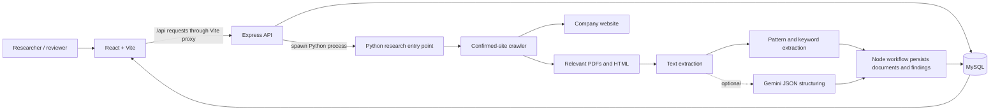

# Service Learning CSR Research System

A Windows-friendly React, Express, Python, and MySQL application for managing a company directory and gathering source-linked CSR/ESG/BRSR research from company websites. Research findings are suggestions for human review, not legal or compliance determinations.

The project does not search the web to guess a company’s official website. A researcher must provide or confirm the site. The crawler stays on that site (plus explicitly approved company subdomains), respects `robots.txt`, applies page and download limits, and records errors rather than treating inaccessible material as successful evidence.

## Contents

- [Purpose and current scope](#purpose-and-current-scope)
- [Architecture and data flow](#architecture-and-data-flow)
- [Repository map](#repository-map)
- [Technology and prerequisites](#technology-and-prerequisites)
- [Supported Windows terminals](#supported-windows-terminals)
- [First-time installation on Windows](#first-time-installation-on-windows)
- [Environment configuration](#environment-configuration)
- [MySQL setup](#mysql-setup)
- [How to Start the Project](#how-to-start-the-project)
- [Using the web application](#using-the-web-application)
- [API overview](#api-overview)
- [Research pipeline details](#research-pipeline-details)
- [Tests and build checks](#tests-and-build-checks)
- [Troubleshooting](#troubleshooting)
- [Limitations and security notes](#limitations-and-security-notes)

## Purpose and current scope

The application is intended for CSR researchers, sustainability/ESG teams, and reviewers who need to collect public company material and verify claims against their sources.

Implemented functionality:

- Company create, edit, delete, duplicate-name protection, website storage, directory search, filters, and pagination.
- Dashboard metrics and a recent research-run list, sourced from MySQL.
- Asynchronous research runs with progress, status, counts, errors, and warnings persisted in MySQL.
- A bounded crawler for a confirmed company website, including robots rules, delays, same-site redirects, DNS/public-address checks, URL de-duplication, and page/size limits.
- PDF and HTML download and text extraction, with a content cache and statuses for empty/scanned, encrypted, unsupported, or failed documents.
- Deterministic CSR finding extraction and optional Gemini-based structuring.
- Review actions to edit, approve, reject, or mark a finding/field unavailable.
- Persisted, paginated research history and run-specific document/finding views.
- Original extracted values retained when reviewers edit findings, plus CSV and print-friendly reports.

Not implemented:

- OCR for scanned PDFs or dedicated extraction of report tables.
- Search-engine/domain discovery, automatic source verification, or automatic acceptance of findings.
- User accounts, authentication, role-based access, production hosting configuration, or a separate job queue.
- Automated cleanup of local cached research documents when a company is deleted.

The researcher must still confirm that the entered domain belongs to the intended company, review the evidence and financial year, and decide whether each result is correct and usable.

## Architecture and data flow



For web research, `POST /api/companies/:id/research` creates a queued run and returns a run ID. The Express process then invokes Python and stores progress/results in MySQL. The frontend polls persisted run state and can reload run-specific documents and findings after refresh. The work runs in the API process; this is not an independent worker service. On API restart, persisted queued/running runs are marked failed as interrupted.

The Python engine is an internal child process of the backend. Researchers use the React application; no terminal-driven research step is required. MySQL is required for the web application’s company, run, review, history, and reporting features. The API binds to loopback by default and has no authentication; do not expose it to an untrusted network.

The frontend development server proxies `/api` to the backend loopback listener, avoiding a cross-origin browser request in the documented local setup. The API has no authentication and does not configure CORS for arbitrary origins.

## Repository map

```text
.
├── .env.example                 Safe environment-variable template (no real secrets)
├── .gitignore                   Excludes local env, virtualenvs, dependencies, and caches
├── README.md                    This setup, operation, and developer guide
├── requirements.txt             Required Python packages
├── requirements-gemini.txt      Optional Gemini packages
├── backend/
│   ├── package.json             Express scripts and dependencies
│   ├── package-lock.json        Locked backend npm dependency tree
│   ├── server.js                Express API routes and process lifecycle
│   ├── database.js              MySQL connection pool and transactions
│   ├── researchWorkflow.js      Run lifecycle and database persistence
│   ├── researchService.js       Node-to-Python subprocess bridge
│   ├── validation.js            Company name and website validation
│   └── test/                    Node API/validation tests
├── database/
│   ├── schema.sql               MySQL database and table definitions
│   ├── migrations/               Additive updates for existing installations
│   └── seed.sql                 Deliberately contains no sample research rows
├── frontend/
│   ├── package.json             Vite scripts and React dependencies
│   ├── package-lock.json        Locked frontend npm dependency tree
│   ├── index.html               Vite page entry
│   ├── vite.config.js           React plugin, root env directory, /api proxy
│   ├── README.md                Short frontend-specific setup pointer
│   └── src/
│       ├── main.jsx             React mount point
│       ├── App.jsx              Dashboard, company directory, profile, review UI
│       ├── api.js               Fetch wrapper for the Express API
│       └── index.css            App styles
└── research/
    ├── company_domains.json     Small sample domain registry; verify before use
    ├── research.py              Internal Python JSON entry point and orchestration
    ├── crawler.py               Bounded, robots-aware official-site crawler
    ├── document_extractor.py    Download, local cache, PDF/HTML text extraction
    ├── information_extractor.py Pattern/keyword and optional Gemini extraction
    └── tests/test_research.py   Mocked Python tests
```

Local/generated paths such as `.venv/`, `backend/node_modules/`, `frontend/node_modules/`, `frontend/dist/`, Python bytecode, and `research/documents/` are not source-of-truth files and are ignored by Git. The npm lockfiles are committed and should be used with `npm ci`. There is no Python lockfile: `requirements.txt` specifies package names without pinned versions, so pip resolves compatible package versions at install time.

## Technology and prerequisites

| Component | Actual use | Requirement |
|---|---|---|
| Node.js and npm | Express API, Python process bridge, Vite tooling | Node.js 22.12+ recommended; Vite’s locked engine range also accepts Node 20.19+ |
| Python | Crawler, document processing, extraction | Python 3.10+ |
| React 19 | Browser UI | Installed through the frontend npm lockfile |
| Vite 8 | Frontend dev server and build | Installed through the frontend npm lockfile |
| Express 5 | HTTP API | Installed through the backend npm lockfile |
| mysql2 | MySQL driver and promise API | Installed through backend npm dependencies |
| MySQL | Persistent company, run, document, and finding records | MySQL 8+ and a running local/accessible server |
| requests, BeautifulSoup | HTTP requests and HTML parsing | Installed from `requirements.txt` |
| pypdf | PDF text extraction | Installed from `requirements.txt` |
| google-genai, python-dotenv | Optional Gemini extraction and `.env` loading in Python | Installed only from `requirements-gemini.txt` |
| Node `node:test` | Backend tests | Built into Node; no separate test runner |
| Python `unittest` | Researcher tests | Built into Python |

The frontend has no dedicated test script or frontend test suite. Its available automated verification is the Vite production build.

## Supported Windows terminals

The project can be operated from either **Windows Command Prompt (CMD)** or **Windows PowerShell**, including the matching shell selected in a VS Code integrated terminal. The examples below assume the repository root is `C:\path\to\service-learning-repo`; replace that placeholder with the folder where you cloned the repository.

To open the correct project:

- In VS Code, choose **File → Open Folder…** and select the repository root containing `backend`, `frontend`, `research`, and `database`.
- Choose **Terminal → New Terminal**. Use the terminal profile selector to choose either Command Prompt or PowerShell.
- Confirm the terminal is at the repository root before running root-level commands.

Directory changes differ by shell:

| Shell | Change to repository root | Change to a project subdirectory |
|---|---|---|
| CMD | `cd /d C:\path\to\service-learning-repo` | `cd backend` |
| PowerShell | `Set-Location 'C:\path\to\service-learning-repo'` | `Set-Location backend` |

`npm run ...` works in CMD. In PowerShell, if script execution policy blocks the `npm` PowerShell shim, use `npm.cmd run ...` for the same npm command; this does not change the project script.

## First-time installation on Windows

Install/configure once per computer or clone. Run each command from the directory indicated.

### 1. Check required software

Open a CMD or PowerShell terminal. Node and Python version checks:

**CMD (any directory):**

```cmd
node --version
npm --version
py --version
where node
where npm
where py
```

**PowerShell (any directory):**

```powershell
node --version
npm --version
py --version
Get-Command node,npm,py,python -ErrorAction SilentlyContinue
```

The project’s Vite lockfile requires Node 20.19+ or 22.12+; use Node 22.12+ (or a newer supported release). Python 3.10+ is required. MySQL 8+ is required for the web app’s persistent functionality. The MySQL command-line client should also be installed or available on `PATH` to apply the schema using the terminal commands below; MySQL Workbench can be used to run SQL files instead.

If a command is not found, install that product using its Windows installer, allow the installer to add it to `PATH` when offered, then close and reopen VS Code so its terminals receive the updated `PATH`. Do not assume that a Python, MySQL, or Node installation already exists.

### 2. Open the repository root

Clone or copy the repository, then open the directory containing `README.md` in VS Code. In a terminal, change to that folder:

**CMD:**

```cmd
cd /d C:\path\to\service-learning-repo
dir
```

**PowerShell:**

```powershell
Set-Location 'C:\path\to\service-learning-repo'
Get-ChildItem
```

The listing should include `backend`, `frontend`, `research`, `database`, `requirements.txt`, and `README.md`.

### 3. Install backend Node dependencies

Run in the **`backend` directory**. `npm ci` installs from the committed backend lockfile and does not start the server.

**CMD:**

```cmd
cd /d C:\path\to\service-learning-repo\backend
npm ci
```

**PowerShell:**

```powershell
Set-Location 'C:\path\to\service-learning-repo\backend'
npm ci
```

If PowerShell blocks `npm`, use `npm.cmd ci`.

### 4. Install frontend Node dependencies

Run in the **`frontend` directory**.

**CMD:**

```cmd
cd /d C:\path\to\service-learning-repo\frontend
npm ci
```

**PowerShell:**

```powershell
Set-Location 'C:\path\to\service-learning-repo\frontend'
npm ci
```

If PowerShell blocks `npm`, use `npm.cmd ci`.

### 5. Create and activate the Python virtual environment

The application expects the virtual environment at the **repository root** as `.venv`. The Node-to-Python bridge looks for `.venv\Scripts\python.exe` there by default.

From the **repository root**, create the environment:

**CMD:**

```cmd
cd /d C:\path\to\service-learning-repo
py -3 -m venv .venv
```

**PowerShell:**

```powershell
Set-Location 'C:\path\to\service-learning-repo'
py -3 -m venv .venv
```

Activate it when you want to run Python commands:

**PowerShell:**

```powershell
.\.venv\Scripts\Activate.ps1
```

**CMD:**

```cmd
.venv\Scripts\activate.bat
```

Activation is optional. The commands below can use the venv’s interpreter path directly and avoid activation-policy issues:

**PowerShell:**

```powershell
.\.venv\Scripts\python.exe --version
```

**CMD:**

```cmd
.venv\Scripts\python.exe --version
```

If PowerShell says script execution is disabled, either use CMD activation or avoid activation and call `.venv\Scripts\python.exe` directly. If you prefer PowerShell activation, a limited per-terminal workaround is:

```powershell
Set-ExecutionPolicy -Scope Process -ExecutionPolicy Bypass
.\.venv\Scripts\Activate.ps1
```

This changes policy only for that PowerShell process and is not a machine-wide policy change. Close the terminal to discard it. When finished with an activated environment, run `deactivate` in either shell.

### 6. Install required Python dependencies

Run from the **repository root** using the activated environment or the explicit venv path:

**CMD:**

```cmd
.venv\Scripts\python.exe -m pip install --upgrade pip
.venv\Scripts\python.exe -m pip install -r requirements.txt
```

**PowerShell:**

```powershell
.\.venv\Scripts\python.exe -m pip install --upgrade pip
.\.venv\Scripts\python.exe -m pip install -r requirements.txt
```

These are the core research dependencies. Gemini is not required for crawling or local extraction.

### 7. Create the local environment file

The Node backend loads the repository-root `.env`. Vite also reads this root `.env` because `frontend/vite.config.js` sets `envDir: '..'`. Do not overwrite an existing `.env`.

Run from the **repository root**:

**CMD:**

```cmd
if not exist .env copy .env.example .env
notepad .env
```

**PowerShell:**

```powershell
if (-not (Test-Path .env)) { Copy-Item .env.example .env }
notepad .env
```

Set MySQL values in the local file using the account created in the next step. The example file contains placeholders only. Do not commit `.env` or put a real credential in source files. `.gitignore` excludes `.env` and other `.env.*` files while allowing `.env.example`.

### 8. Install and start MySQL

Install MySQL Server 8+ for Windows and retain the administrator credentials you selected during installation privately. If you install MySQL Workbench, it can provide a GUI to connect and execute the schema; Workbench itself is not used by the application.

Before starting the backend, ensure the MySQL Windows service is running. The service name depends on the installer configuration. Open **Services** (`services.msc`), locate the installed MySQL service, and start it if stopped. Do not assume a particular service name or run a guessed service-start command.

### 9. Create the database schema

Run from the **repository root**, with the MySQL server running. The schema creates the `csr_research` database, the four core tables, and two run-to-record relationship tables. It does not insert sample research data.

**CMD** (MySQL client on `PATH`):

```cmd
mysql --user=root --password < database\schema.sql
```

**PowerShell** (use CMD solely for its input-redirection syntax):

```powershell
cmd.exe /d /c "mysql --user=root --password < database\schema.sql"
```

Both commands prompt for the MySQL administrator password. If the `mysql` command is not found, add the MySQL `bin` directory to `PATH`, use the installed client’s full executable path, or open `database/schema.sql` in MySQL Workbench and execute it there.

Create a restricted application account from the MySQL client or Workbench. Replace the password placeholder with a private local value and never paste that value into this README or a committed file:

```sql
CREATE USER 'csr_app'@'localhost' IDENTIFIED BY 'replace-with-a-private-local-password';
GRANT SELECT, INSERT, UPDATE, DELETE ON csr_research.* TO 'csr_app'@'localhost';
```

If this account already exists, do not blindly rerun `CREATE USER`; use the existing account or update its credential using MySQL’s supported account-management workflow. Put the account values in the root `.env` (`DB_HOST`, `DB_PORT`, `DB_NAME`, `DB_USER`, `DB_PASSWORD`). `database/seed.sql` is intentionally empty of fictitious companies and is not needed for setup.

For an existing installation created with an older `schema.sql`, first make a database backup, then apply `database\migrations\001_research_run_history.sql` followed by `database\migrations\002_run_warning_summary.sql`, once each, using an administrator account or MySQL Workbench. The migrations add a backfilled original-value column, run association tables, and a warning-summary column; they do not drop or delete research records. Existing rows are retained. The old schema had overwritten edited finding values and reassigned deduplicated documents to their most recent run, so earlier original values/run associations that were already lost cannot be reconstructed by a migration. Do not run these migrations on a database initialized from the current `database/schema.sql`.

### 10. Verify configuration and dependencies

From the **repository root**, verify the Python environment:

**CMD:**

```cmd
.venv\Scripts\python.exe --version
.venv\Scripts\python.exe -m pip check
```

**PowerShell:**

```powershell
.\.venv\Scripts\python.exe --version
.\.venv\Scripts\python.exe -m pip check
```

Check each npm installation from its own directory:

**CMD or PowerShell — `backend`:**

```text
npm ls --depth=0
```

**CMD or PowerShell — `frontend`:**

```text
npm ls --depth=0
```

If using PowerShell with restricted script execution, prefix either command with `npm.cmd`.

Start the application as described in [How to Start the Project](#how-to-start-the-project), then open `http://localhost:5000/api/health`. A working DB configuration returns HTTP 200 and JSON indicating `status: "ok"` and `database: "available"`. A 503 response reports missing configuration, schema, or database availability; it does not mean the Node server failed to start.

## Environment configuration

All application settings are in the **repository-root `.env`** created from `.env.example`, unless a variable is explicitly provided in the terminal environment. The Node API loads this file using an explicit root path; the child Python process inherits Node’s environment. Vite reads the same root file through `envDir: '..'`, and only `VITE_` variables are exposed to frontend code.

| Variable | Reader | Required? | Default / safe example | Purpose and effect |
|---|---|---:|---|---|
| `PORT` | Node API | Optional | `5000` | Express listen port. The Vite proxy is fixed to port 5000 in `frontend/vite.config.js`; if you change this, update the proxy too. |
| `DB_HOST` | Node MySQL layer | Required for web application persistence | `localhost` | MySQL server host. Missing value makes health report `not_configured`. |
| `DB_PORT` | Node MySQL layer | Optional | `3306` | MySQL TCP port. |
| `DB_NAME` | Node MySQL layer | Required for persistent use | `csr_research` | Database name created by `database/schema.sql`. |
| `DB_USER` | Node MySQL layer | Required for persistent use | `csr_app` | MySQL account with database CRUD permissions. |
| `DB_PASSWORD` | Node MySQL layer | Required for persistent use | Set privately in `.env`; no real value belongs in docs | Password for `DB_USER`. The app checks that the variable is defined; a wrong/blank credential still causes a MySQL connection failure. |
| `VITE_API_BASE_URL` | Vite frontend | Optional | `/api` | Browser API prefix. Keep relative `/api` for the configured development proxy. |
| `PYTHON_EXECUTABLE` | Node research bridge | Optional | Empty; uses root `.venv\Scripts\python.exe` if present, otherwise `python` on Windows | Absolute path to Python executable when the default is unsuitable. Example placeholder: `C:\path\to\service-learning-repo\.venv\Scripts\python.exe`. |
| `MAX_CRAWL_PAGES` | Node bridge / Python engine | Optional | `40`; Python accepts 1–200 | Maximum HTML pages visited. Node forwards the value to Python. |
| `MAX_CRAWL_DEPTH` | Node bridge / Python engine | Optional | `3`; Python accepts 0–8 | Maximum internal-link depth from the start URL. Node forwards the value to Python. |
| `RESEARCH_TIMEOUT_MS` | Node research bridge | Optional | `600000` (10 minutes) | Maximum time Node waits for a Python run before killing it. |
| `CRAWL_TIMEOUT_SECONDS` | Python researcher | Optional | `15`; crawler clamps to 3–60 seconds | Per HTTP request timeout. |
| `CRAWL_USER_AGENT` | Python researcher/crawler | Optional | `ServiceLearningCSRResearcher/1.0 (educational research)` | User-agent sent to official websites and used for robots rules. |
| `CRAWL_MIN_DELAY_SECONDS` | Python crawler | Optional | `1`; crawler clamps to 0–10 seconds | Minimum delay between requests; a robots crawl-delay can increase this. |
| `CRAWL_ALLOWED_SUBDOMAINS` | Python crawler | Optional | Empty | Comma-separated exact subdomain hostnames explicitly approved under the confirmed root domain. Do not add a host without confirming company control. |
| `MAX_HTML_BYTES` | Python researcher/crawler | Optional | `3000000` (3 MB); crawler clamps to 100 KB–20 MB | Maximum HTML response read per page. |
| `MAX_DOCUMENT_BYTES` | Python document extractor | Optional | `20971520` (20 MB); extractor clamps to 100 KB–100 MB | Maximum size of one downloaded document. |
| `MAX_TOTAL_DOCUMENT_BYTES` | Python document extractor | Optional | `62914560` (60 MB); extractor clamps to 100 KB–200 MB | Maximum total downloaded bytes for a run. |
| `MAX_DOCUMENTS_PER_RUN` | Python document extractor | Optional | `12`; extractor clamps to 1–100 | Maximum discovered document links processed per run. |
| `DOCUMENT_CACHE_TTL_SECONDS` | Python document extractor | Optional | `86400` (one day); extractor clamps to 0–30 days | How long cached document downloads may be reused. Zero disables cache reuse. |
| `DOCUMENT_STORAGE_DIR` | Python document extractor | Optional | `research\documents` under the repository | Local downloaded document/text cache path. Keep it private and backed up only if desired. |
| `GEMINI_API_KEY` | Python information extractor | Optional | Empty | Enables optional Gemini extraction. Without it, deterministic local extraction still runs. Treat the value as a secret. |
| `GEMINI_MODEL` | Python information extractor | Optional | `gemini-flash-latest` | Gemini model name used only when the optional API integration is enabled. |

The root `.env` is automatically read by the Node API. Node passes its current environment to the Python child process, so Python crawl settings and the optional Gemini key are available during web research. The Python engine is not intended to be run as a researcher-facing command.

Temporary environment-variable syntax, if needed:

**CMD (current terminal and child processes):**

```cmd
set "PORT=5000"
```

**PowerShell (current terminal and child processes):**

```powershell
$env:PORT = '5000'
```

These values last only for that terminal session. Prefer the root `.env` for persistent local configuration.

Gemini-only installation, from the **repository root**:

**CMD:**

```cmd
.venv\Scripts\python.exe -m pip install -r requirements-gemini.txt
```

**PowerShell:**

```powershell
.\.venv\Scripts\python.exe -m pip install -r requirements-gemini.txt
```

Leave `GEMINI_API_KEY` empty to use local extraction. If Gemini is missing, errors, returns malformed output, or reaches quota, the code returns a warning and preserves local findings.

## MySQL setup

MySQL is required for the web directory, dashboard, run status persistence, and DB-backed workflow. Starting Express alone does not require a successful DB connection; `/api/health` reports missing/unavailable configuration, and database-backed routes will not work until MySQL is reachable and the schema exists.

The schema in [database/schema.sql](database/schema.sql) creates:

- `companies`: company details and current research status.
- `research_runs`: run status, progress, counters, errors, and warnings.
- `documents`: source URLs, extracted text/status, hashes, and cache storage names.
- `findings`: source-linked values, original and edited values, excerpt, year/page, extraction method, and review state.
- `research_run_documents` and `research_run_findings`: preserve each run's association with deduplicated documents and findings.

The foreign keys cascade related database records when a company is deleted. Local document-cache files are not removed by this cascade.

Schema setup is in [First-time installation on Windows](#9-create-the-database-schema). The schema script uses MySQL syntax and is intended for MySQL 8+. No real credentials, API keys, or research rows are included in the repository.

## How to Start the Project

Complete the one-time installation, `.env` configuration, schema setup, and MySQL service startup first. On normal days, start or verify the MySQL Windows service, then open the following separate terminals. The backend and frontend can be started in either order after MySQL is ready; starting the backend first makes API health checking straightforward.

In VS Code, use **Terminal → New Terminal** for each terminal and select CMD or PowerShell. All working-directory paths below are relative to the repository root.

### Terminal 1 — Backend

Run in the **`backend` directory**:

**CMD:**

```cmd
cd /d C:\path\to\service-learning-repo\backend
npm run devstart
```

**PowerShell:**

```powershell
Set-Location 'C:\path\to\service-learning-repo\backend'
npm run devstart
```

If PowerShell blocks `npm`, use `npm.cmd run devstart`.

This runs the Express API with Node’s watch mode. By default it listens on the local machine at `http://localhost:5000` (loopback only). A successful process logs a line similar to `CSR research API listening on http://localhost:5000`. Keep this terminal open. A configured and reachable database is confirmed separately at `http://localhost:5000/api/health`; a missing DB/schema/migration can yield HTTP 503 even though the API process is listening.

### Terminal 2 — React frontend

Run in the **`frontend` directory**:

**CMD:**

```cmd
cd /d C:\path\to\service-learning-repo\frontend
npm run start
```

**PowerShell:**

```powershell
Set-Location 'C:\path\to\service-learning-repo\frontend'
npm run start
```

If PowerShell blocks `npm`, use `npm.cmd run start`.

This runs Vite. Open the local URL printed in the terminal; the default is `http://localhost:5173`. Requests to `/api` are proxied to Express at `http://127.0.0.1:5000`. Keep this terminal open while using the UI.

### Database and process shutdown

The MySQL Windows service must remain running while using DB-backed features. Verify the application can reach it by opening `http://localhost:5000/api/health`. For a healthy connection, the response is HTTP 200 with `status: "ok"` and `database: "available"`.

Keep backend and frontend terminals open while using the web app. Press **Ctrl+C** in each terminal to stop its foreground Node/Vite process. Stopping the API during a research run causes the next API startup to mark any still-queued/running persisted runs as interrupted/failed. The Python research process is started and managed internally by the backend.

## Using the web application

### Web application workflow

1. Open the frontend URL, usually `http://localhost:5173`.
2. Add or select a company. A sample-registry match may suggest a domain, but the suggestion is not saved or used until the researcher confirms it.
3. Register/confirm the official website, then start research from the company profile or research action. The application prevents a second active run for the same company.
4. Monitor the honest run stage and actual crawl/document counters in the dashboard or persisted **Research history**. Open a run to inspect URLs, document processing outcomes, warnings, and source-linked findings.
5. Review each finding. Edit its value/year and notes if needed, then approve, reject, or return it to pending review. The original extracted value and supporting source excerpt remain available.
6. Open the run report to inspect approved, pending, rejected, and unavailable items, then print the report or export findings as CSV.

The dashboard’s metrics are database-backed and are not sample values. A run does not automatically establish that its source is current, authoritative, or factually correct.

The backend, not the researcher, invokes the Python engine. The Python JSON contract is an internal implementation detail; no CLI terminal is part of normal installation, startup, research, review, or reporting.

## API overview

All API routes are prefixed with `/api`. Success response shapes below describe the code; they have not necessarily been observed in a live, configured database. JSON errors generally have the shape `{ "error": "..." }`.

| Method and path | Purpose | Request | Success shape in implementation |
|---|---|---|---|
| `GET /api/health` | API/database health | None | Health/status and database state; may return HTTP 503 for missing/unavailable DB/schema/migrations |
| `GET /api/dashboard` | Dashboard totals and recent runs | None | Counts plus up to eight recent runs |
| `GET /api/company-domain-suggestions?company_name=` | Suggest a registry URL for an exact company/alias match | Company name | `{ suggested_website, requires_confirmation }`; never confirms automatically |
| `GET /api/companies?q=&industry=&research_status=&page=` | Filtered/paginated directory | Optional query parameters; 50 records/page | `companies`, `industries`, `pagination` |
| `POST /api/companies` | Create company | JSON company fields | HTTP 201 `{ company }` |
| `GET /api/companies/:id` | Company profile | Numeric ID | `{ company, research_runs, documents, findings }` |
| `PATCH /api/companies/:id` | Edit company | JSON company fields | `{ company }` |
| `DELETE /api/companies/:id` | Delete company and related DB history | Numeric ID | HTTP 204, no body |
| `POST /api/companies/:id/research` | Queue a research run | Numeric company ID | HTTP 202 `{ research_run: { id, status: "queued" } }` |
| `POST /api/research` | Compatibility start endpoint | `{ companyName, website? }` | HTTP 202 with queued run ID |
| `GET /api/research?page=&limit=` | Persisted paginated research history | Optional page and 1–100 limit | `research_runs`, `pagination` |
| `GET /api/research/:id` | Retrieve run, company, documents, and findings | Numeric run ID | `{ research_run, company, documents, findings }` |
| `GET /api/research/:id/documents` | List documents for run | Numeric run ID | `{ documents }` |
| `GET /api/documents/:id` | Read document record/extracted text | Numeric document ID | `{ document }` |
| `GET /api/companies/:id/findings` | List company findings | Numeric company ID | `{ findings }` |
| `POST /api/companies/:id/findings` | Manually mark a field unavailable | `{ field_name }` | HTTP 201 `{ finding }` |
| `PATCH /api/findings/:id/review` | Edit finding and review state | `review_status`; optional `finding_value`, `financial_year`, `reviewer_notes` | `{ finding }` |

IDs must be positive safe integers. Research statuses and finding review statuses are validated. A second active run for a company returns `409`. Company creation/edit errors include invalid input (`400`) and normalized-name duplicates (`409`); missing IDs return `404`. Database availability is required for data routes. To verify the API without modifying records, use `GET /api/health`; the bundled tests also exercise health and pre-database validation.

## Research pipeline details

1. **Domain input:** Web research uses the company website explicitly confirmed and stored in the company row.
2. **Domain registry:** `research/company_domains.json` is a small sample mapping, not a general registry or external discovery system. Exact matches can suggest a URL in the web UI, but the researcher must confirm it.
3. **Validation:** Node and Python normalize HTTP/HTTPS URLs and reject credentials, IP literal URLs, non-standard ports, and invalid hosts. The crawler checks DNS resolution and rejects non-public addresses.
4. **Crawling:** `OfficialSiteCrawler` uses a priority queue, follows HTML links up to page/depth limits, and prioritizes CSR/sustainability/ESG/BRSR/annual-report/governance/social-impact terms.
5. **Scope and politeness:** The confirmed host is allowed by default. Optional explicit subdomains must be subordinate to that host. Redirects are checked before following, robots.txt is consulted, and configured/robots crawl delays and request timeouts apply.
6. **Document discovery:** PDF links and recognized office-document links are collected. The crawler also returns relevant HTML pages. Office files are recorded as unsupported; they are not executed.
7. **Download and cache:** Download processing is bounded by per-file, total-run, and document-count limits. A per-company local manifest caches supported PDF/HTML files by URL and content hash for the configured TTL. Relevant HTML pages are stored as text files.
8. **Text extraction:** `pypdf` extracts selectable text from up to 200 pages per PDF and retains page numbers. BeautifulSoup extracts text from HTML. Encrypted, scanned/empty, unsupported, and failed documents are not represented as successfully extracted text. No OCR is present.
9. **Local findings:** Regex detects some Indian currency amounts and financial-year formats. Keyword/sentence rules produce CSR-related observations, focus areas, projects, committees, and partner findings. It does not do dedicated table parsing and can miss content.
10. **Optional Gemini:** If `GEMINI_API_KEY` is configured and `google-genai` is installed, relevant passages may be sent for schema-constrained JSON structuring. The code checks fields, excerpt/value correspondence, source URL, year, and page evidence. Gemini is not required; errors/quota/malformed responses result in a warning while local findings remain.
11. **Persistence and human review:** Node stores documents/findings with company/run IDs, source URLs, hashes, excerpts, years/pages, and extraction method. Run-link tables preserve run-specific document/finding membership despite cross-run deduplication. New automated findings start as `pending_review`; edits preserve the first extracted value and original excerpt.

The Python JSON mode writes progress events followed by a result object. The Node bridge consumes those lines, ignores unrelated stdout diagnostics rather than confusing them with result JSON, enforces timeout/output limits, and passes the result to the database workflow. This operation depends on the configured Python executable and installed Python requirements.

## Tests and build checks

Run tests/build from the directories specified. These commands use local dependencies; they do not intentionally crawl a live website or make Gemini calls.

### Backend tests

Run from **`backend`**:

```text
npm test
```

On PowerShell if needed: `npm.cmd test`. The script runs Node’s built-in test runner (`node --test`). Tests cover missing-DB health behavior, validation before database access, history/review input validation, unconfirmed domain suggestions, and the unknown-domain Python bridge behavior. They are not a full MySQL CRUD integration suite.

### Python tests

Run from the **repository root**:

**CMD:**

```cmd
.venv\Scripts\python.exe -m unittest discover -s research\tests -v
```

**PowerShell:**

```powershell
.\.venv\Scripts\python.exe -m unittest discover -s research\tests -v
```

These tests use mocked HTTP responses and temporary files for URL/crawler rules, robots handling, document extraction/cache behavior, and extraction behavior. They do not crawl live company websites.

### Frontend check

There is no frontend test script. To verify the frontend compiles, run from **`frontend`**:

```text
npm run build
```

On PowerShell if needed: `npm.cmd run build`. The build writes the production bundle to `frontend/dist/`; this repository does not configure a production web server.

## Troubleshooting

The project-specific behaviors below come from the checked-in code/configuration. Network, machine, and third-party installer problems are possibilities and must be diagnosed on the affected computer; they are not claimed as existing project defects.

### `node`, `npm`, `py`, or `python` is not recognized

**CMD diagnostic:**

```cmd
where node
where npm
where py
where python
```

**PowerShell diagnostic:**

```powershell
Get-Command node,npm,py,python -ErrorAction SilentlyContinue
```

Install the missing runtime, ensure its installer adds it to `PATH`, close/reopen VS Code, and retry the version checks. Use Node 22.12+ (or Node 20.19+) and Python 3.10+. The project’s Node bridge uses the root `.venv` automatically when present.

### PowerShell blocks npm or Python environment activation

PowerShell may resolve `npm` to a `.ps1` shim. Use `npm.cmd` instead, for example `npm.cmd run devstart`. For Python, use `.venv\Scripts\python.exe` directly. Alternatively, activate the environment from CMD with `.venv\Scripts\activate.bat`. If you choose to allow PowerShell activation, use the per-process command shown in [Python virtual environment setup](#5-create-and-activate-the-python-virtual-environment), not a machine-wide policy change.

### Missing Node packages

Check you are in the correct directory:

**CMD:**

```cmd
cd
dir package.json
```

**PowerShell:**

```powershell
Get-Location
Test-Path package.json
```

Run `npm ci` from `backend` or `frontend` as appropriate. Do not run `npm ci` from the repository root; there is no root Node package manifest. If installation reports registry/network/TLS errors, verify network access and retry from the affected app directory.

### Python dependency installation or import failure

Run the install from the **repository root** using the venv interpreter:

**CMD:**

```cmd
.venv\Scripts\python.exe -m pip --version
.venv\Scripts\python.exe -m pip install -r requirements.txt
```

**PowerShell:**

```powershell
.\.venv\Scripts\python.exe -m pip --version
.\.venv\Scripts\python.exe -m pip install -r requirements.txt
```

If Python is below 3.10, install a supported Python and recreate `.venv`. If Node reports that Python cannot be started, confirm `.venv\Scripts\python.exe` exists or set `PYTHON_EXECUTABLE` in root `.env` to an installed executable path.

### Wrong working directory

`npm run devstart` must be run in `backend`; `npm run start` and `npm run build` must be run in `frontend`. Python requirements, venv creation, and SQL setup are run from the repository root. Research is launched through the web interface; do not start `research.py` separately. Use `cd /d ...` in CMD or `Set-Location ...` in PowerShell.

### Missing `.env` or invalid settings

Create root `.env` only if absent, using the copy command in installation step 7. Do not replace a working `.env` when pulling changes. Check names against the [environment table](#environment-configuration) without printing credentials in terminal output or logs. `DB_HOST`, `DB_NAME`, `DB_USER`, and `DB_PASSWORD` must be defined for `isDatabaseConfigured()` to report configured; incorrect values still fail actual DB access.

### MySQL connection or schema errors

Check:

1. The MySQL service is running in `services.msc`.
2. Root `.env` uses the correct host, port, database name, user, and password.
3. `database/schema.sql` has been executed successfully for a new database, or both versioned migration files have been applied once to an older database.
4. The configured app user has CRUD privileges on `csr_research.*`.
5. No credential has trailing spaces or been added with mismatched quotes.

Then open `http://localhost:5000/api/health`. It distinguishes not-configured, schema-missing, and unavailable DB states. The repository does not bundle a MySQL server or credentials.

### Backend/frontend ports already in use

The backend defaults to port 5000. Vite defaults to 5173 and proxies `/api` to port 5000.

**CMD:**

```cmd
netstat -ano | findstr ":5000"
netstat -ano | findstr ":5173"
```

**PowerShell:**

```powershell
Get-NetTCPConnection -LocalPort 5000,5173 -ErrorAction SilentlyContinue
```

Stop only the process you recognize and started, preferably with Ctrl+C in its terminal. If you intentionally change the backend `PORT`, also update the proxy target in `frontend/vite.config.js`. Do not terminate an unknown process just to free a port.

### Frontend cannot reach backend / CORS message

In the documented development arrangement, the browser talks to Vite at port 5173 and Vite proxies `/api` to Express at port 5000. Confirm both terminals remain running, `VITE_API_BASE_URL` is `/api`, and `http://localhost:5000/api/health` responds. The Express API does not enable arbitrary CORS; do not work around the local proxy by exposing the API publicly.

If you changed the API port, change `frontend/vite.config.js` proxy target and restart Vite. Vite reads its environment at startup; restart after changing root `.env`.

### Python subprocess cannot start or research returns an error

The Node bridge chooses `PYTHON_EXECUTABLE` if set; otherwise it prefers repository-root `.venv\Scripts\python.exe`, then the Windows `python` command. Check the interpreter and core imports:

**CMD from repository root:**

```cmd
.venv\Scripts\python.exe --version
.venv\Scripts\python.exe -c "import requests, bs4, pypdf; print('core imports ok')"
```

**PowerShell from repository root:**

```powershell
.\.venv\Scripts\python.exe --version
.\.venv\Scripts\python.exe -c "import requests, bs4, pypdf; print('core imports ok')"
```

If the venv is absent, follow installation steps 5–6. If Python lives elsewhere, set `PYTHON_EXECUTABLE` to its absolute path and restart the backend. Research has a configurable `RESEARCH_TIMEOUT_MS` defaulting to ten minutes.

### Gemini quota, key, or package issues

Gemini is optional. Keep `GEMINI_API_KEY` empty to use local deterministic extraction. If Gemini is enabled but quota is exhausted, the model request fails, or the optional package is missing, the code returns a warning and local findings remain available. Install `requirements-gemini.txt` only if opting into Gemini. Never paste the API key into issue reports or commit it.

### Research finds no pages or documents

The app intentionally does not guess domains or use search engines. Confirm the company’s official URL and that it is stored on the company record. Inspect the run’s `error_summary`/`warning_summary` and document statuses. Robots rules, network failures, redirect boundaries, site structure, subdomain restrictions, or crawl limits can prevent discovery. Add only verified subdomains to `CRAWL_ALLOWED_SUBDOMAINS`; consider carefully adjusting page/depth limits.

HTML pages are considered relevant using CSR-related terms. PDFs and recognized document links can be discovered; unsupported file types are not processed. A document listing or a crawl result is not proof that its claims are accurate or current.

### PDF extraction is empty or fails

`scanned_or_empty` means pypdf found no selectable text; OCR is not implemented. `encrypted` means the PDF is protected. `failed` indicates extraction/download/storage failure; inspect its processing error. Corrupt, oversized, unsupported, or unreachable files may fail or be skipped. Use the cited source manually or provide an OCR process outside this application; no OCR command is supplied by this project.

## Limitations and security notes

- Findings require human verification and should not be treated as audited/legal facts.
- There is no OCR, full table extraction, production hosting configuration, authentication, or multi-user authorization.
- This is an educational/local research application. Do not expose the unauthenticated API to an untrusted network.
- Only explicitly confirmed company domains and explicitly approved subordinate hosts are crawled; off-host redirects are rejected.
- Robots rules, crawl delays, DNS/public-IP checks, request timeouts, and configured data limits can reduce coverage.
- Deleting a company cascades its MySQL research records but does not automatically remove local cached documents.
- The Python package requirements are not version-locked.
- The included tests are mocked/smoke coverage, not live-site, Gemini, or full MySQL integration tests.

Before relying on any result, inspect the original source URL, passage, page/year where present, and confirm the information manually.
